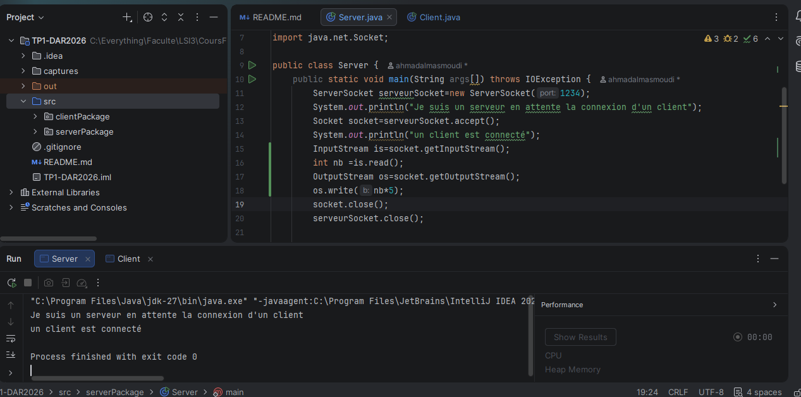
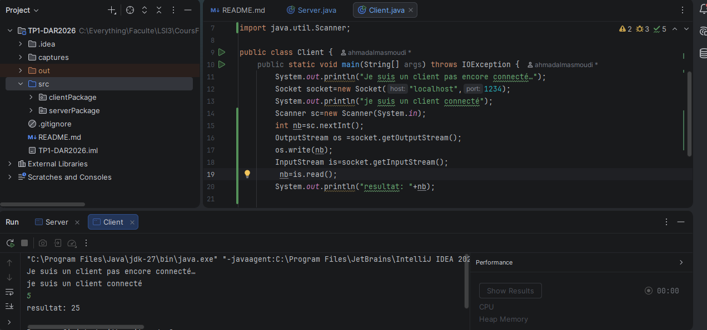
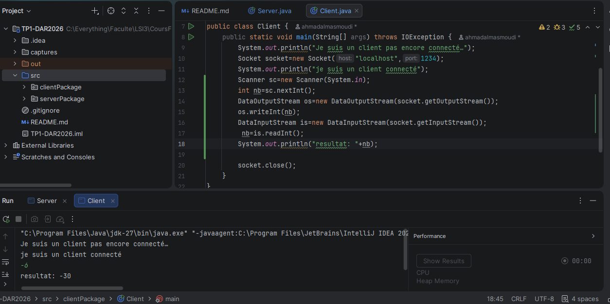
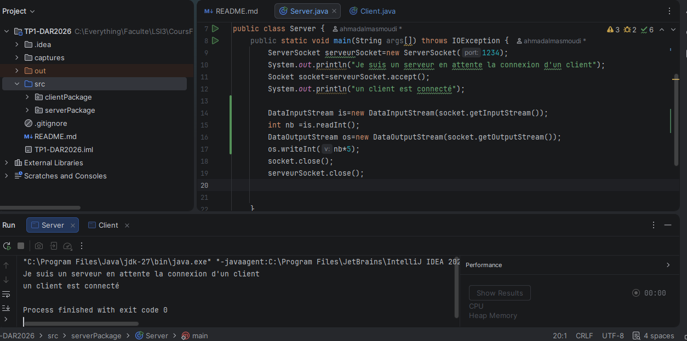
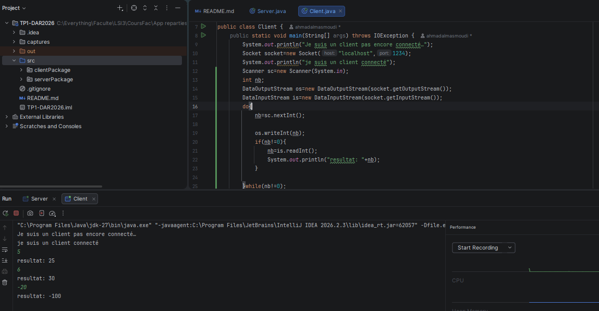
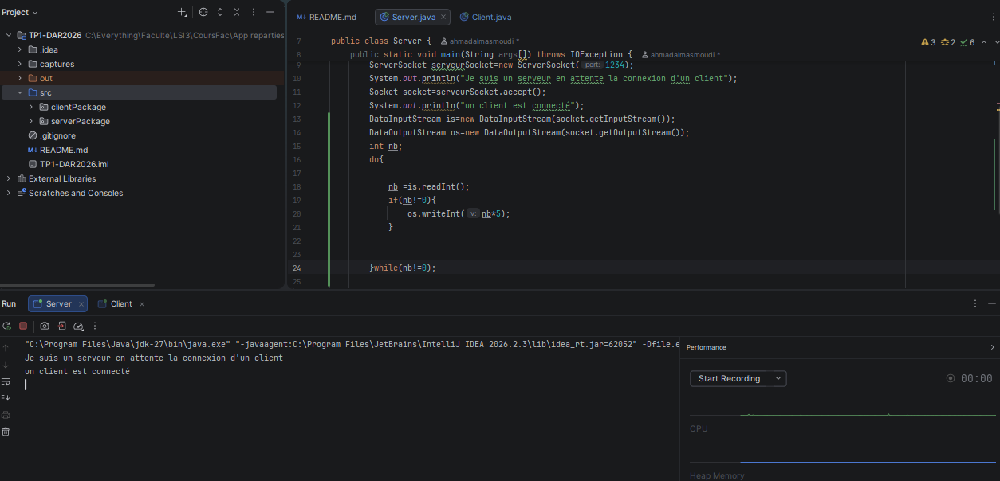

# Étape 2 : Création du service de multiplication

**Nom :** Masmoudi

**Prénom :** Ahmed

## 1. Réalisation du service de multiplication (Questions 1 à 3)

Le client saisit un entier au clavier et l’envoie au serveur à travers une connexion TCP. Le serveur reçoit cet entier, calcule son produit par 5 et renvoie le résultat au client, qui l’affiche. Plusieurs valeurs positives, négatives et nulles sont testées afin de vérifier le bon fonctionnement du programme.

## 2. Utilisation de DataInputStream et DataOutputStream (Question 4)

Les classes `DataInputStream` et `DataOutputStream` sont utilisées pour lire et envoyer des entiers sous forme binaire entre le client et le serveur. Les méthodes `readInt()` et `writeInt()` permettent de transmettre correctement les entiers positifs, négatifs et nuls sans conversion en chaînes de caractères.

## 3. Gestion de plusieurs saisies et arrêt de la communication (Question 5)

Le client peut saisir plusieurs entiers successivement. Après chaque saisie différente de zéro, le serveur calcule le produit par 5 et renvoie le résultat au client. Lorsque le client saisit zéro, cette valeur sert de signal d’arrêt : les boucles se terminent et les sockets sont fermées des deux côtés.

