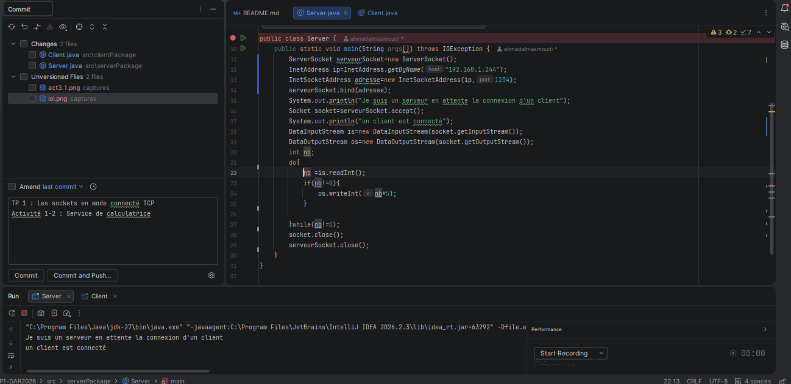
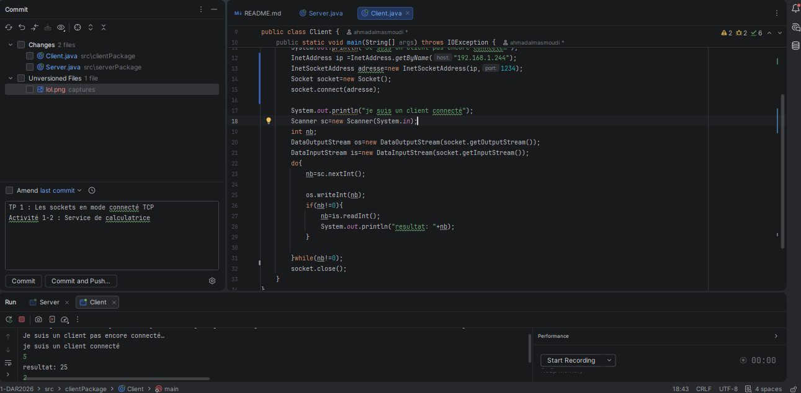
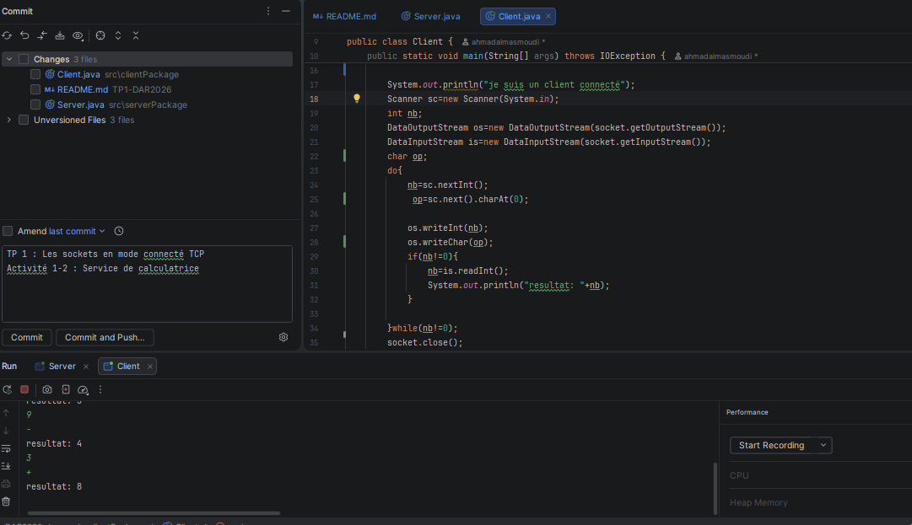
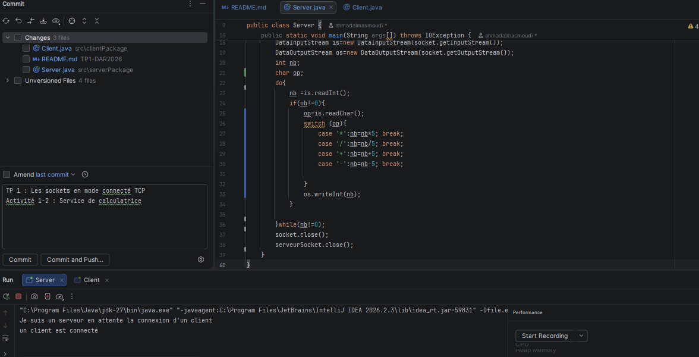

# TP 1 : Les sockets en mode connecté TCP

## Activité 1-3 : Amélioration sur le service de calculatrice

**Nom :** Masmoudi

**Prénom :** Ahmed

## Étape 1 : Connexion Client/Serveur sur deux machines distinctes

Cette étape consiste à adapter l’application Client/Serveur développée dans l’Activité 1-2 afin de permettre la communication entre deux machines distinctes connectées au même réseau local. Les classes `InetAddress` et `InetSocketAddress` sont utilisées pour gérer l’adresse IP et le port de communication. Le serveur écoute sur l’adresse IP de sa machine et sur un port choisi, tandis que le client utilise l’adresse IP du serveur pour établir la connexion TCP.

## Étape 2 : Amélioration du service de calculatrice

Cette étape consiste à enrichir le service de calculatrice développé précédemment en ajoutant de nouvelles fonctionnalités à l’application Client/Serveur.

