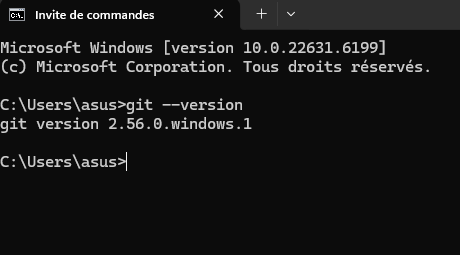
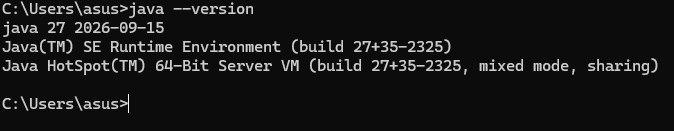
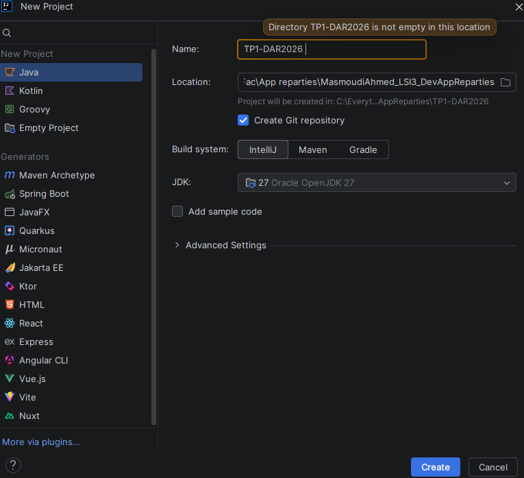
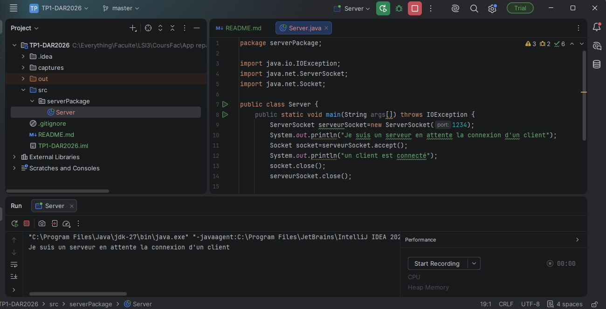
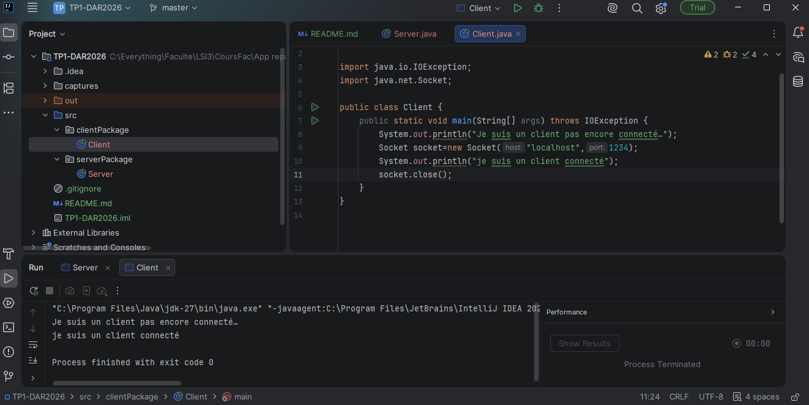

# TP 1 : Les sockets en mode connecté TCP Activité 1-1 : Première connexion Client/Serveur
**Réalisé par :** Masmoudi Ahmed 

**Filière :** LSI3

**Groupe TP :** 2.1
## Étape 1 : Préparation de l’environnement Git

Vérification de l’installation de Git sur le système à l’aide de la commande `git --version`, afin de confirmer que Git est installé et prêt à être utilisé pour la gestion des versions du projet.

## Étape 2 : Préparation de l’environnement Java

Vérification de la version de Java installée à l’aide de la commande `java --version`, puis création du répertoire du projet `votreNomPrenom_LSI3_DevAppReparties` pour organiser le travail.

## Étape 3 : Création du serveur

Création du projet Java `TP1-DAR2026` et du package `serverPackage` contenant la classe `Server`. Le code du serveur est complété, puis l’application est exécutée afin de vérifier que le serveur démarre et attend la connexion d’un client.

## Étape 4 : Création du client

Création du package `clientPackage` contenant la classe `Client`, puis exécution du client pour établir une connexion avec le serveur. Les résultats affichés dans les consoles permettent de vérifier le bon fonctionnement de la communication client-serveur. Enfin, l’adresse `localhost` est remplacée par l’adresse IP du serveur.

